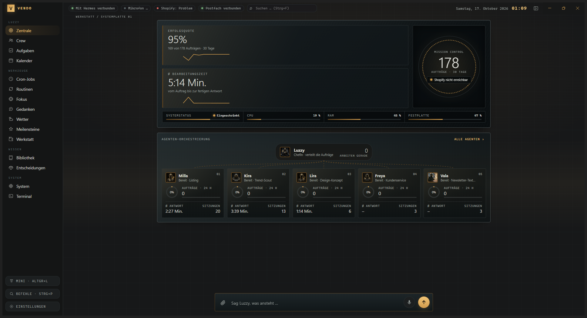

# Vendo

**A voice-enabled desktop command center for Hermes Agent.**



> **Project status:** Vendo is a small, privately maintained project with a public source repository. It is still under active development, but most of its core features work in the intended Windows and Hermes setup. Expect bugs, rough edges, and changes as development continues.

Vendo brings a voice interface, Hermes conversations, desktop utilities, and everyday workflows into one Windows application. Hermes provides the AI models, agents, tools, and sessions; Vendo provides the desktop interface and connects selected local capabilities.

## Features

- **Voice:** Talk to Luzzy with speech recognition, an optional wake word, and text-to-speech. Pocket TTS can speak locally; Gemini TTS and ElevenLabs are optional cloud providers.
- **Hermes conversations and agents:** Chat with configured Hermes profiles, follow agent activity, and use approvals for actions that need confirmation.
- **Everyday workflows:** Manage tasks, calendar events, reminders, focus sessions, routines, notes, and milestones. Weather is available through Open-Meteo.
- **Notifications:** View configured Shopify order notifications, mail notifications provided through Hermes, job failures, milestones, and reminders.
- **Desktop tools:** Search and preview local files, edit selected text with an explicit save step, dictate into the clipboard, use a PowerShell terminal, and run supported PC controls.
- **Mini mode:** Keep a compact desktop assistant visible with the Fenni animated companion and key status information.
- **Plugins:** Extend the interface with local plugin views, cards, commands, and workflows. The workshop can draft, check, and test plugins before you approve installation.
- **Local fallback:** When enabled and configured, Ollama can provide limited assistance if Hermes is unavailable. Features that require Hermes or cloud services are not available through this fallback.

Most features depend on the local Hermes installation and its profile configuration. Optional integrations require their own accounts, credentials, and setup.

## How It Works

Vendo is an Electron application with a Node.js main process and a JavaScript/HTML/CSS renderer. It connects to Hermes on the same computer through Hermes' local REST API and WebSocket interface. It can attach to a running Hermes backend or start one when needed.

Hermes remains a separate application. Vendo does not modify Hermes program code. It may update selected Hermes profile or user configuration values for supported integrations; it creates a backup before those changes.

## Requirements

- Windows 10 or 11
- Git, to clone the repository from the terminal
- Node.js LTS and npm
- A locally installed Hermes Agent with a profile configured for Vendo

Optional components include a microphone, `uv` for Pocket TTS, Ollama for local fallback, and accounts or credentials for Shopify, mail, Gemini TTS, or ElevenLabs. Vendo does not bundle these services or credentials.

## Download the Repository

With Git installed, clone the public repository using one terminal command:

```powershell
git clone https://github.com/Kynto-intel/vendo.git
```

This creates a `vendo` folder. Open a terminal in that folder to install dependencies and start the app.

## Run from Source

```powershell
npm install
npm start
```

This launches the Electron application from source. Hermes Agent must be installed and configured separately.

## Data and Integrations

- App settings and plugin data are stored locally and excluded from the public Git repository. Never commit credentials, tokens, personal data, or local backups.
- Prompts sent to Hermes may be processed by the model provider configured in Hermes.
- Pocket TTS generates speech locally. Gemini TTS and ElevenLabs send speech text to their respective providers.
- Connected services such as Shopify, mail, and weather communicate with their providers when their integrations are used. Data handling depends on each provider and configuration.
- Vendo asks for confirmation for selected sensitive actions and backs up files before certain edits. Review AI output and verify actions before relying on them.

## License

Vendo is licensed under the [Vendo Attribution License](LICENSE). Personal and internal business use are allowed. Selling Vendo or offering it to others as a product or service is not allowed, and the original project must not be presented as someone else's work. This is a custom license, not a standard MIT or OSI-approved license.
